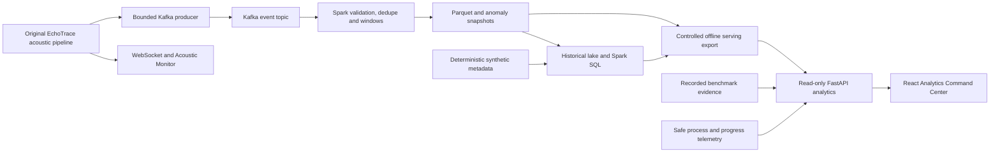
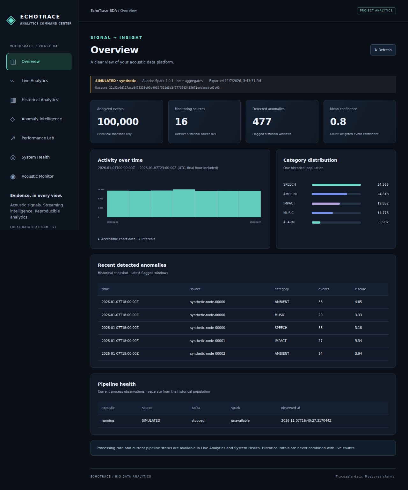
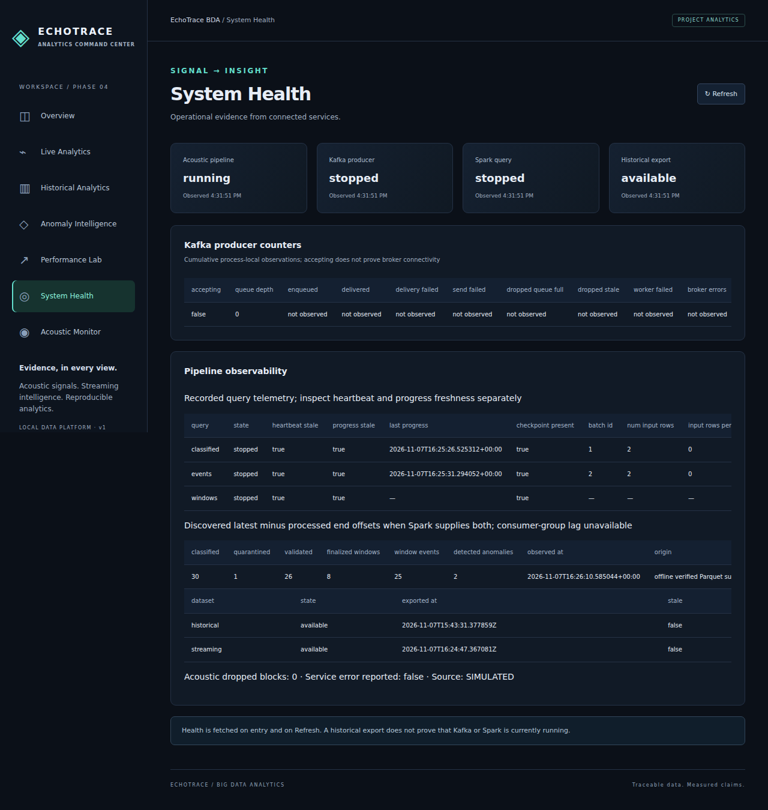

# EchoTrace-BDA

**Acoustic events to traceable analytics — Kafka ingestion, Spark processing, and an evidence-backed command center.**

EchoTrace-BDA extends the original local acoustic event-detection system with a
reproducible Big Data Analytics platform. It preserves EchoTrace's event detection,
LEFT/CENTRE/RIGHT localization and explainable acoustic sequences, then adds a
versioned Kafka side channel, event-time streaming analytics, historical Parquet
storage, Spark SQL, a React dashboard, and isolated reliability experiments.

The problem: individual sound detections provide limited context over time. A
useful analytical system must preserve source identity, handle duplicates and late
arrivals, expose historical patterns, and make its performance and failure claims
inspectable. This project demonstrates that workflow on a resource-bounded local
stack. It supplements human interpretation; it is not a validated emergency-response
or identity-tracking product.

## Capabilities

- **Acoustic monitoring:** original LIVE, RECORDED and clearly SIMULATED modes;
  PANNs CNN14 inference where configured, approximate two-microphone localization,
  linked-event sequences and the preserved Acoustic Monitor interface.
- **Event streaming:** Kafka 4.1.2, strict v1 event schemas, stable record identities,
  a bounded asynchronous producer, acknowledgements and visible loss counters.
- **Streaming analytics:** Spark 4.0.1 validation/quarantine, watermark-bounded
  deduplication, finalized windows, explainable count/baseline anomaly snapshots,
  durable stage checkpoints and freshness-aware telemetry.
- **Historical analytics:** deterministic synthetic event generation, immutable
  Parquet snapshots, Spark SQL, reviewed serving exports and bounded read-only APIs.
- **Analytics workspace:** Overview, Live Analytics, Historical Analytics, Anomaly
  Intelligence, Performance Lab and System Health, alongside Acoustic Monitor.
- **Reproducibility:** raw benchmark measurements, source manifests, isolated
  Kafka-to-browser verification, documented failed attempts and recovery limits.

## Architecture



See [six implementation diagrams](docs/academic/ARCHITECTURE.md) and the
[full project report](docs/academic/PROJECT_REPORT.md). Spark is executed locally
with `local[1]`/`local[2]`; no multi-machine scaling result is claimed.

## Verified results

These are **historical committed measurements**, reconciled in the
[evidence inventory](docs/academic/EVIDENCE_INDEX.md). The multi-million datasets
contain SIMULATED event metadata, not millions of microphone detections.

| Result | Verified observation | Scope |
| --- | --- | --- |
| Generated/benchmarked volume | 5,000,000 synthetic event records | Largest generated and benchmarked dataset; [E02](docs/academic/EVIDENCE_INDEX.md#e02) |
| Completed historical lake | 1,000,000 validated events | Largest complete Parquet snapshot; [E05](docs/academic/EVIDENCE_INDEX.md#e05) |
| Benchmark record population | 72 results: 54 measured + 18 warmups | Nine configurations, two engines; [E03](docs/academic/EVIDENCE_INDEX.md#e03) |
| Specific 5m analytical workload | Python median 70.6890 s; Spark 32.7002 s; about 2.16x | Setup excluded; local two-CPU/3 GiB environment; [E04](docs/academic/EVIDENCE_INDEX.md#e04) |
| 1m validated Parquet size | 113,032,004 bytes vs 482,385,125 raw JSONL bytes | About 23.43% of raw size; [E06](docs/academic/EVIDENCE_INDEX.md#e06) |
| Controlled producer/ingest experiment | 100 events/s target, 60 s measured after 15 s warmup | 6,000 measured + 1,500 warmup acknowledged/validated; downstream drained sequentially; [E10](docs/academic/EVIDENCE_INDEX.md#e10) |
| Category SQL median | 31.27 → 5.88 ms | Same aggregate copy, covering indexes, extra storage; [E11](docs/academic/EVIDENCE_INDEX.md#e11) |
| Actual integration | Simulated acoustic events → Kafka → Spark → Parquet → API → browser | Eight acoustic events within an isolated controlled population; [E08](docs/academic/EVIDENCE_INDEX.md#e08) |

Python was faster at 100k; the 2.16x comparison is not a general Spark superiority
claim. Benchmark setup, generation and full-lake preparation are not included in
that ratio. No 10m execution or complete 5m historical lake is claimed.

## Dashboard



The default UI serves a **100,000-event SIMULATED historical snapshot** with 16
historical source IDs and 477 detected windows. It does not silently substitute the
million-record lake or combine benchmark totals with live buffers.



Additional evidence: [generated Spark output in the browser](bda/reports/phase5/pipeline-dashboard.png),
[mobile view](bda/reports/phase5/overview-mobile.png),
[original benchmark charts](bda/reports/phase3/charts/).
Screenshots are recorded observations, not a promise that services are running now.

## Quick start: weight-free demonstration

From the repository root on Linux/macOS, install Python and Node plus the system
audio libraries required by imports. The recorded host used Python 3.14.2 and Node
24.22.2; the separate Spark runtime uses Python 3.10.12. On Debian/Ubuntu, obtain
`libportaudio2` and `libsndfile1` with your system package manager.

```bash
git clone https://github.com/elementary1645/Echotrace-BDA.git
cd Echotrace-BDA
infrastructure/dashboard/run.sh setup
infrastructure/dashboard/run.sh serve
```

Open **http://127.0.0.1:8000/**. This starts the original scripted acoustic pipeline
as **SIMULATED**, plus committed historical/benchmark outputs. It requires no neural
weights, Kafka, Docker or ignored local datasets. Dependency installation needs
internet; after dependencies are installed, the recorded-output demo can run locally.
The weight-free launcher intentionally rejects LIVE/RECORDED inference; those use
the normal backend launcher described below.

## Full professor demonstration

Follow the [checked step-by-step script](docs/academic/DEMO_SCRIPT.md), including
its clearly labeled fallback if infrastructure cannot start. For actual isolated
Kafka/Spark verification, first prepare dependencies/images/browser support in the
[operations guide](bda/reliability/OPERATIONS.md), then:

```bash
infrastructure/reliability/run.sh preflight
# Choose a new output directory and an unused dedicated loopback port every run.
infrastructure/reliability/run.sh verify artifacts/phase5/professor-001 --campaign --port 19096
```

The workflow creates its own broker, topics, run root and checkpoints, verifies
actual pipeline outputs through Chromium, and stops its disposable broker. It
retains run evidence and its new Kafka volume. Existing application infrastructure
is not reset. Do not use `down -v` or delete checkpoints to “repair” a demonstration.
Large five-million-record benchmarks need not be rerun for the presentation.

## Original microphone and recorded inference

The [original Windows acoustic guide](docs/backend_readme_section.md) retains
hardware calibration and recording instructions; its earlier Node recommendation
predates the current frontend. Use the current frontend setup above. For the
original Python 3.12/Windows inference environment, preserve the existing commands:

```powershell
py -3.12 -m venv backend\.venv
# CPU installation; select a compatible CUDA build separately when appropriate.
backend\.venv\Scripts\python.exe -m pip install torch
backend\.venv\Scripts\python.exe -m pip install -r backend\requirements.txt
backend\.venv\Scripts\python.exe backend\scripts\download_weights.py
backend\.venv\Scripts\python.exe backend\scripts\list_devices.py
backend\.venv\Scripts\python.exe backend\scripts\calibrate_direction.py
backend\.venv\Scripts\python.exe backend\scripts\serve.py --source live
```

CNN14 weights and AudioSet labels are external; hardware, compatible inference
packages and genuine stereo channels are required. The current BDA release does
not re-establish microphone accuracy or neural-model performance. Original acoustic
metrics and their tuning-on-the-same-clips disclosure remain in [metrics.md](docs/metrics.md).

## Testing and release checks

```bash
# With pytest/httpx and the documented backend dependencies installed:
.venv/bin/python -m pytest -q
npm --prefix frontend test
npm --prefix frontend run build
python3 docs/academic/check_delivery.py
# Cached pinned Spark image required; no five-million-record benchmark:
infrastructure/batch/run.sh test
```

The [Phase 6 validation record](bda/PHASE6_VALIDATION.md) lists actual final-release
runs and skips. Earlier [Phase 5 tests](bda/PHASE5_VALIDATION.md) included 271 Python
passes with generated-output opt-in, 19 streaming passes, 20 batch passes and
separate real Kafka/browser checks; these overlapping suites are not a single
summed test population. Full testing/reproduction details are in the
[demo guide](docs/academic/DEMO_SCRIPT.md) and [operations guide](bda/reliability/OPERATIONS.md).

## Technology and repository map

| Layer | Technology | Main modules |
| --- | --- | --- |
| Acoustic detection and existing interface | Python, PANNs CNN14, GCC-PHAT | [backend/echotrace](backend/echotrace/), [AcousticConsole](frontend/src/AcousticConsole.tsx) |
| Ingestion and contracts | Kafka 4.1.2, confluent-kafka, Pydantic | [schema](bda/schema.py), [adapter](bda/event_adapter.py), [producer](bda/producer.py), [consumer](bda/consumer.py) |
| Stream processing | Spark 4.0.1 Structured Streaming | [bda/streaming](bda/streaming/) |
| Historical data and benchmarking | Spark SQL, Parquet, deterministic JSONL | [bda/batch](bda/batch/) |
| Serving and dashboard | FastAPI, SQLite aggregate exports, React/TypeScript, Vite | [analytics API](backend/echotrace/api/analytics.py), [bda/analytics](bda/analytics/), [frontend](frontend/) |
| Reliability and operations | Docker Compose, pytest, Vitest, Playwright | [bda/reliability](bda/reliability/), [infrastructure](infrastructure/) |
| Evidence and delivery | JSON journals, charts, Markdown/Mermaid | [reports](bda/reports/), [academic docs](docs/academic/), [portfolio](docs/portfolio/RESUME.md) |

```text
backend/          Original acoustic engine, FastAPI and regression tests
frontend/         Analytics workspace and preserved operational console
bda/              Kafka integration, streaming, batch, serving and reliability
bda/reports/      Committed measurements, manifests, selected outputs and screenshots
infrastructure/   Kafka/Spark/batch/dashboard/reliability launchers and pinned runtime
recordings/       Original small evaluation clips and labels where committed
artifacts/        Ignored runtime datasets, checkpoints and experimental outputs
docs/academic/    Report, diagrams, slides, demo, concepts, viva and evidence index
docs/portfolio/   Evidence-constrained resume and interview material
```

## Limitations and safety

- Local Spark and one broker are not a verified multi-machine cluster or HA service.
- The producer is bounded best effort; queue drops, timeouts and shutdown can lose
  records. Checkpoints do not recover events never delivered to Kafka. No end-to-end
  exactly-once claim is made.
- Deduplication is bounded by event-time watermarks; idle streams may leave trailing
  windows unfinalized. Very late records may be excluded from analytical state.
- Benchmark/data, frontend buffer, historical snapshot and telemetry populations
  remain separately labeled. Consumer-group lag and per-record Spark latency are
  unavailable where not measured.
- Plaintext development Kafka and local unauthenticated APIs are not production
  security hardening. Keep them on trusted local interfaces.
- The earlier legacy-broker data-loss incident remains disclosed in
  [Phase 2 validation](bda/PHASE2_VALIDATION.md); later safeguards do not undo it.

## Documentation, contribution and attribution

Start with the [academic report](docs/academic/PROJECT_REPORT.md),
[architecture](docs/academic/ARCHITECTURE.md),
[presentation specification](docs/academic/PRESENTATION.md),
[Big Data concept map](docs/academic/BIG_DATA_CONCEPTS.md),
[viva questions](docs/academic/VIVA_QUESTIONS.md), and
[portfolio wording](docs/portfolio/RESUME.md).
Phase records: [1](bda/VALIDATION.md), [2](bda/PHASE2_VALIDATION.md),
[3](bda/PHASE3_VALIDATION.md), [4](bda/PHASE4_VALIDATION.md),
[5](bda/PHASE5_VALIDATION.md), [6](bda/PHASE6_VALIDATION.md).

This repository retains the original EchoTrace acoustic system and its imported
Git history. LICENSE credits **Chinmay**; original history also includes frontend
contribution by **Aditya Karadi**. The BDA extension adds ingestion, analytical
processing, serving and reproducible evaluation; it does not claim authorship of
PANNs or the original acoustic model. Contributions should preserve source labels,
existing data/checkpoints, test evidence and attribution, and provide reproducible
commands for changed behavior.

Code is [MIT licensed](LICENSE), copyright © 2026 Chinmay. Model weights are not
bundled; the repository's license note identifies separately downloaded PANNs
weights as CC BY 4.0. Consult the upstream [PANNs paper](https://arxiv.org/abs/1912.10211)
and [model record](https://zenodo.org/records/3987831) for model attribution and terms.
