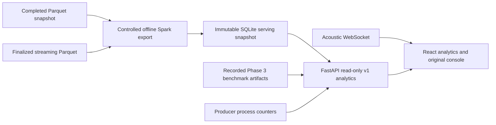

# Phase 4 — Analytics Command Center

The React/Vite dashboard now opens an analytics workspace with Overview, Live
Analytics, Historical Analytics, Anomaly Intelligence, Performance Lab and System
Health. Acoustic Monitor preserves the original operational console, including
source controls, acoustic map, linked sequences, timeline, meters and evaluation.
Hash navigation supports direct links and browser history. The original console
is lazy loaded. No Kafka/Spark analytical definitions were changed.

## Architecture audit and integration plan

Inspected the existing App/component tree, CSS, `useEchoTrace`, API proxy, FastAPI
routes/engine, Phase 2/3 documentation and validation records, batch queries/lake,
streaming transforms/storage/progress and published Phase 3 artifacts before editing.
The initial integration plan was: retain the acoustic interface, add an analytics
shell, export completed Parquet aggregates offline into SQLite, serve bounded
read-only APIs, use original benchmark trials, and distinguish unavailable telemetry.

| Source | Existing contract | Dashboard integration |
| --- | --- | --- |
| Acoustic pipeline | `/ws` `{type,data}`; frames/status/events/sequences | Bounded current browser buffer; explicitly not Spark statistics |
| Historical snapshot | Completed Parquet `validated`, `anomalies`, manifest | Offline Spark export to immutable read-only SQLite |
| Finalized streaming | Parquet `windows`, anomaly snapshot pointer | Optional offline serving export; no active-query health inference |
| Producer | `EventProducer.snapshot()` | Process counters, accepting/disconnected/stopped/unavailable distinctions |
| Benchmarks | Phase 3 trials, environment, storage, dataset manifests | Original 72 measurements; medians exclude warmups |
| Ground truth | Generator manifest `injected_anomalies` | Separate table, never pooled with detections |

See [API contract](analytics/API.md), [demonstration](analytics/DEMO.md), and
[validation](PHASE4_VALIDATION.md). Screenshots: [desktop](reports/phase4/overview-desktop.png)
and [mobile](reports/phase4/overview-mobile.png).

## Provenance and aggregation

The checked-in historical serving snapshot contains **100,000 SIMULATED events**,
16 source IDs, Jan 1–7 2026 UTC, and 477 actual detected windows from `lake-100k`.
It is separate from the million-record aggregate sample and five-million-record
raw benchmark. SQLite contains 68,160 aggregate cells, not raw event records.
Cells group UTC hour, original source, source ID, category, zone and confidence
bucket. Counts and confidence sums preserve correct weighted means under filtering.
Confidence buckets are `[0,.1)` ... `[.9,1]`; no individual confidence is fabricated.
Anomaly baseline fields and flags are copied from the Parquet anomaly output.
The baseline uses previous observed windows, not zero-filled hours. No severity or
model probability is inferred. The 1,000 injected ALARM events are separately labeled.

The export receipt records the dataset identity, snapshot checksum, bytes and
independent total/category/day checks against the generator manifest. Serving is
read-only and never starts Spark. Export is a deliberate operator command, refuses
existing outputs, checks the completion marker and verifies exported event totals.
The optional streaming path respects Spark dataset roots and the snapshot pointer,
uses original source classifications, and reports its threshold as unknown because
Phase 2 configuration does not persist anomaly parameters.

## Performance and behavior

The browser retains at most 200 events and 200 sequences. WebSocket reconnect uses
bounded exponential backoff (500 ms to 5 s), cancels on unmount and rejects malformed
messages. Live counts use buffered events and a stream-time window; early-session
rate divides by a fixed 60 seconds and is not end-to-end throughput. Freshness
warnings identify disconnected/idle feeds. Snapshots older than 24 hours are marked
as recorded stale history. No service is marked healthy because the UI loaded.

Requests validate allowlisted dimensions, identifiers, timezone-aware UTC whole-hour
boundaries, half-open ranges and a maximum 366-day explicit interval. SQL values are
bound, pagination is capped, and each SQLite connection has a two-second instruction
progress budget. No user-provided paths, SQL or Spark options are accepted. SQLite's
bounded page cache and OS cache support historical reads; benchmark parsing has a
single-entry process cache because the versioned artifacts are immutable. Deploy a
new process when replacing benchmark artifacts. Replace SQLite atomically between
requests, never mutate it in place. Maximum chart payload is 500 aggregate rows per
dimension; longer selections show a truncation warning and should use daily view.

## Limitations

- No active Spark query listener is connected to the web process. Query liveness,
  checkpoints, progress offsets and last successful streaming update are explicitly
  unavailable. The optional streaming export is a recorded finalized snapshot.
- The optional streaming response contains at most the latest 200 aggregate cells;
  it is not a complete streaming warehouse. Only historical confidence histograms
  are available; finalized streaming windows contain means, not confidence buckets.
- Current source activity is grouped by mode because the acoustic WebSocket has no
  device/source ID. Historical source IDs describe historical activity, not active
  devices. Live frontend counters can miss events while disconnected or beyond the
  server's reconnect snapshot; they are never labeled all-time totals.
- The professor demo starts a clearly simulated pipeline without neural weights.
  Use the normal backend launcher and its documented prerequisites for actual
  microphone/recorded inference. Microphone/model inference was not tested here.
- Kafka/Spark services remain opt-in and retain existing storage safeguards. This
  phase does not revalidate multi-machine scaling, HA or every infrastructure
  failure mode. Existing live infrastructure tests remain opt-in.
- Historical UI exports are bounded JSON results for the current selection/page,
  not raw event downloads. UTC midnight date controls give whole-day selections;
  the API also supports exact UTC hour boundaries.
