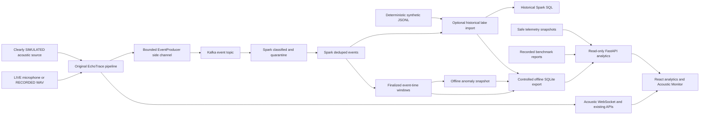
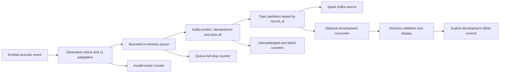
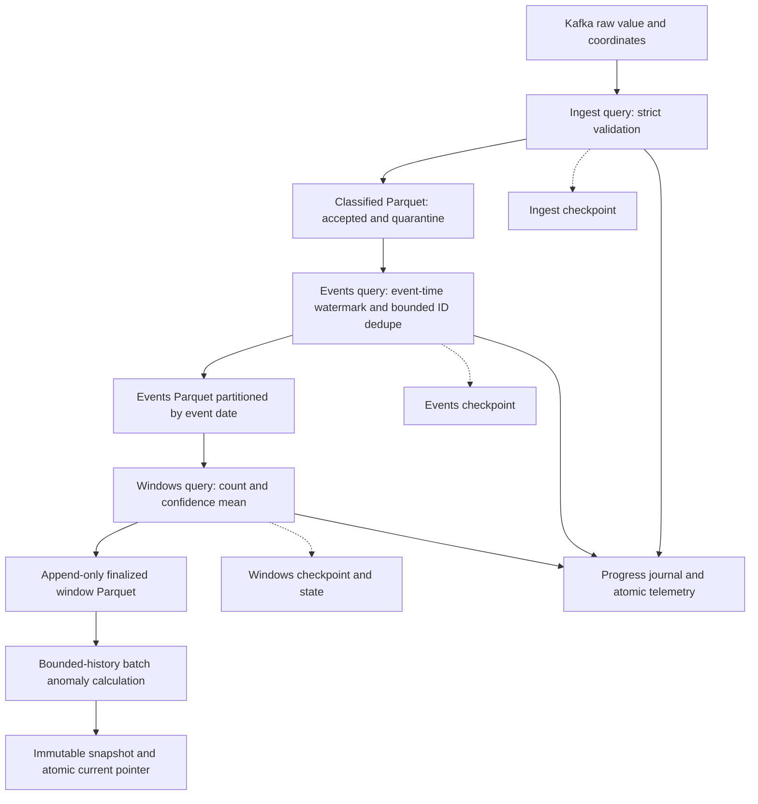
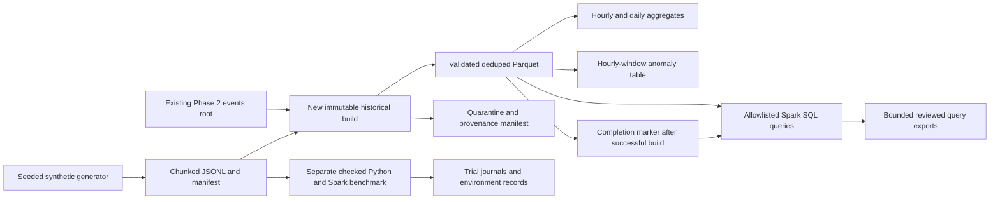
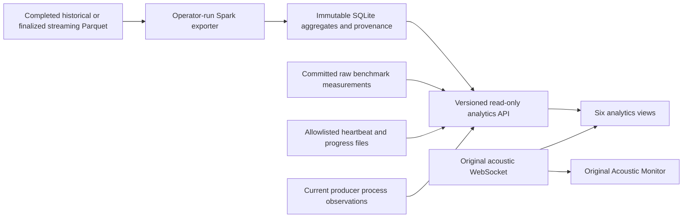
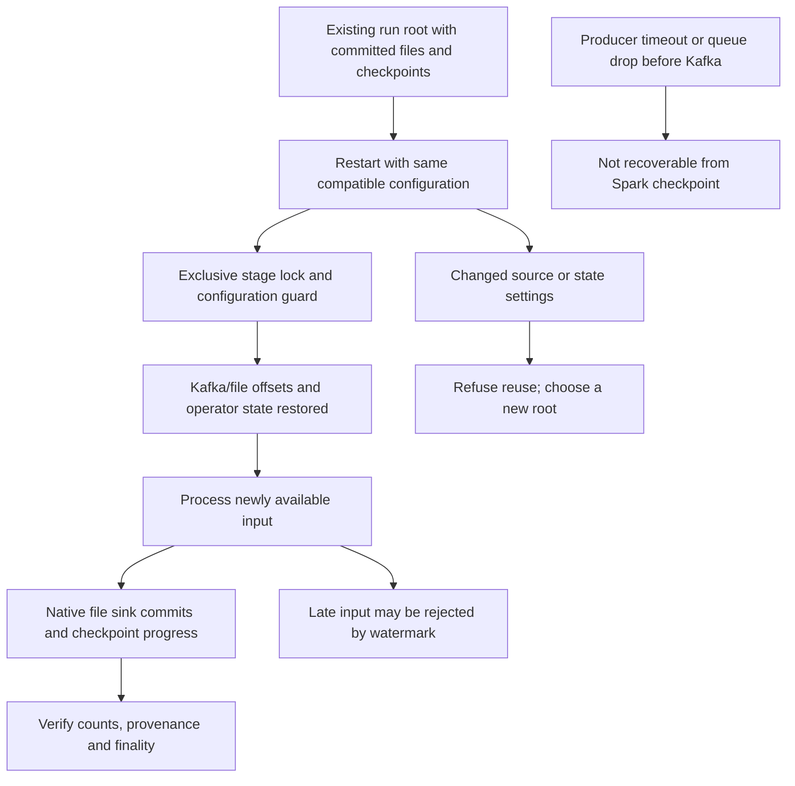

# Implementation architecture

These diagrams describe the merged implementation, not a proposed cluster.
Execution is local Spark in Docker; Kafka is a single KRaft broker with three-partition
application/test topics and replication factor one. Path ownership and lineage matter
more than the visual separation of boxes. [Evidence inventory](EVIDENCE_INDEX.md#e01).

## 1. Full system

**Code:** [pipeline](../../backend/echotrace/pipeline.py),
[server bridge](../../backend/echotrace/api/server.py), [streaming job](../../bda/streaming/job.py),
[lake](../../bda/batch/lake.py), [exporter](../../bda/analytics/export.py).
The engine's broadcaster is the actual Kafka submission boundary. The direct
pipeline-to-producer arrow denotes this side-channel integration, not Kafka I/O on
the acoustic worker thread. Historical and streaming exports are selected operator
workflows, not automatic lake refresh on every event.

## 2. Kafka producer and consumer flow

**Code:** [adapter](../../bda/event_adapter.py), [producer](../../bda/producer.py),
[consumer](../../bda/consumer.py), [settings](../../bda/config.py).
The producer has no durable outbox. `acks=all` cannot provide replicated durability
with a single broker and replication factor one. The development consumer reports
invalid input then advances its offset by policy; Spark uses its own checkpoints,
not those development-consumer commits.

## 3. Structured Streaming stages

**Code:** [job](../../bda/streaming/job.py), [transforms](../../bda/streaming/transforms.py),
[ownership guards](../../bda/streaming/storage.py), [listener](../../bda/streaming/metrics.py).
Separate processes may run continuous stages, but the recorded resource-bounded
campaign used concurrent ingestion and sequential downstream draining. Anomaly
calculation is a batch over finalized windows, not a second stateful streaming
operation. Idle wall time does not advance event-time watermarks.

## 4. Historical processing

**Code:** [generator](../../bda/batch/generate.py), [lake builder](../../bda/batch/lake.py),
[query definitions](../../bda/batch/queries.py), [benchmark](../../bda/batch/benchmark.py).
The completion marker is a build-level publication guard, not a distributed ACID
transaction protocol. Large raw/Parquet datasets remain outside Git.

## 5. Dashboard serving

**Code:** [API](../../backend/echotrace/api/analytics.py),
[telemetry reader](../../bda/analytics/observability.py),
[React app](../../frontend/src/App.tsx), [original console](../../frontend/src/AcousticConsole.tsx).
HTTP requests do not launch Spark. SQL identifiers are allowlisted, values bound,
responses paginated, and SQLite work budgeted. WebSocket charts use a bounded
browser buffer; their population is distinct from Spark-exported statistics.

## 6. Recovery and checkpoints

**Code/tests:** [claim guard](../../bda/streaming/storage.py),
[streaming recovery tests](../../bda/streaming/tests/test_spark.py),
[real isolated restart verification](../../bda/reliability/run.py).
Checkpoint recovery was tested; abrupt disk failure, replicated broker failover
and end-to-end exactly-once delivery were not established. Read datasets at their
Spark roots so native metadata logs are honored. Never delete checkpoints separately
from the outputs and source epoch they describe.
