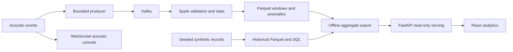
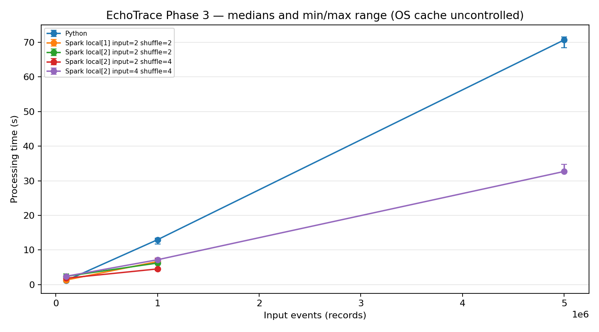
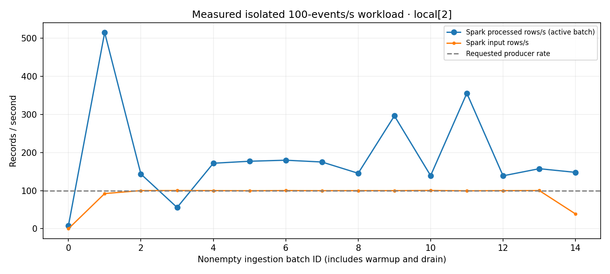

# EchoTrace-BDA: Acoustic Event Streaming and Historical Analytics

**Academic project report — final delivery, November 7, 2026**

| Title-page field | To be completed by the submitting student |
| --- | --- |
| Institution / department | [Institution and department] |
| Degree / course / semester | [Programme and course] |
| Student name / registration number | [Student details] |
| Project guide | [Guide name and designation] |
| Academic year | [Academic year] |
| Repository | `elementary1645/Echotrace-BDA` |
| Audited implementation baseline | `33ce36e`, merged BDA phases 1–5 |

These placeholders do not represent institutional approval, certification or
identified authorship. Original code attribution and licensing are retained in
[LICENSE](../../LICENSE) and the [evidence index](EVIDENCE_INDEX.md#e14).

## Abstract

EchoTrace-BDA extends an existing acoustic monitoring application into an
inspectable analytics workflow. The original application detects sound events,
approximates horizontal direction and links detections into explainable sequences.
The extension publishes versioned event metadata through a bounded Kafka producer,
processes it with Spark Structured Streaming, preserves accepted and rejected data,
aggregates finalized event-time windows, and supports historical Parquet/Spark SQL
analysis. A React interface presents reviewed analytics through bounded read-only
FastAPI endpoints, while keeping the original monitoring interface accessible.

The project emphasizes evidence and failure boundaries. Deterministic SIMULATED
metadata datasets of up to five million events were generated and benchmarked;
one million events were fully converted into a completed historical lake. For one
checked five-million-record grouping workload, recorded median Python/Spark times
were 70.6890/32.7002 seconds, about 2.16x, excluding setup. An isolated experiment
also verified actual simulated acoustic flow through Kafka, Spark, Parquet, API
and browser, including checkpoint restart and deliberately late records. A separate
60-second measured publishing interval targeted 100 events/s. These observations
are local, workload-specific results, not multi-machine capacity or end-to-end
exactly-once guarantees. [E02–E05](EVIDENCE_INDEX.md#e02),
[E08–E10](EVIDENCE_INDEX.md#e08).

## 1. Introduction

A single acoustic classification is an observation, not a complete operational
explanation. Repeated alarms, changes in activity and sequences of different sounds
require information across time. Retaining that information introduces data-platform
questions: how are records identified, how are duplicate arrivals handled, what
happens when transport fails, and which statistics can a user trust?

EchoTrace-BDA addresses those questions by extending an existing local acoustic
engine rather than replacing it. The application remains capable of live,
recorded and simulated source modes. The BDA layer consumes event metadata, not
continuous raw audio. This separation permits repeatable high-volume analytics
experiments without pretending that millions of synthetic records were acoustic
model inferences. See [E01](EVIDENCE_INDEX.md#e01) and [E14](EVIDENCE_INDEX.md#e14).

## 2. Problem statement

The original monitoring workflow can show recent detections and explain linked
sequences, but a finite recent-event buffer is insufficient for durable historical
analysis or reproducible data-platform evaluation. A useful extension must:

1. Preserve source classification and record identity across component boundaries.
2. Isolate acoustic processing from slow or unavailable messaging infrastructure.
3. Separate malformed input from valid analytical data without hiding rejection.
4. Define event-time, duplicate and late-arrival behavior precisely.
5. Serve bounded, explainable analytical results without allowing arbitrary expensive jobs.
6. Provide repeatable correctness, reliability and performance evidence.

The question is whether these components form a verifiable workflow on limited
local resources. It is not whether a local prototype can claim production emergency
response accuracy, large-cluster scaling or guaranteed zero data loss.

## 3. Objectives and achievement criteria

| Objective | Implemented outcome | Evaluation basis |
| --- | --- | --- |
| Decouple detection and analytics transport | Optional bounded asynchronous producer | Delivery/queue tests and real Kafka smoke |
| Process event-time streams | Validation, bounded deduplication and finalized windows | Spark tests and actual isolated run |
| Retain analytical history | Immutable validated Parquet snapshots and SQL queries | Completed 1m snapshot, checked query exports |
| Explain unusual activity | Absolute count and preceding-observed-window baseline flags | Actual anomaly outputs and baseline tests |
| Make evidence accessible | Six analytics views and preserved acoustic console | API, component and browser checks |
| Measure performance reproducibly | Journals, environment records, repeated comparisons | Raw Phase 3 trials and Phase 5 workload/index experiment |
| Document failure boundaries | Timeout loss, restart, quarantine and freshness observations | Reliability matrix and receipts |

The project meets these bounded criteria; production hardening and multi-machine
experiments remain future work. [E01](EVIDENCE_INDEX.md#e01),
[E08–E13](EVIDENCE_INDEX.md#e08).

## 4. Motivation and background

The original EchoTrace system combines pretrained PANNs CNN14 audio tagging with
project-specific category thresholds, event debounce, approximate GCC-PHAT
localization and temporal sequence logic. It has a useful distinction between
recognizing a sound and explaining a sequence of sounds. The BDA extension applies
a corresponding distinction between receiving a record and publishing a trustworthy
analytical result.

Kafka is used as a decoupling log; Spark supplies event-time/stateful processing
and SQL execution; Parquet supplies persistent columnar analytical storage.
None of those choices automatically supplies correct application semantics.
The implementation therefore specifies identity, provenance, finality, checkpoint
ownership and measurement populations explicitly. Background references are listed
in section 26; project results rely on committed local evidence.

## 5. Big Data characteristics

**Volume:** the generator and benchmark processed up to five million synthetic
event records (2.412 GB raw JSONL). The completed lake reached one million events.
The default dashboard population is smaller and explicitly labeled.

**Velocity:** Kafka ingestion and micro-batches process arrival streams; a controlled
100-events/s target was exercised. This is not a verified ceiling or a claim of
long-running complete-pipeline throughput.

**Variety:** source classifications LIVE/RECORDED/SIMULATED, categories, confidence,
zone, timestamps and validation outcomes vary. The analytics contract is still one
structured event schema, not a general multimodal warehouse.

**Veracity:** deterministic manifests, schema checks, quarantine, stable identities
and independent Python/Spark output comparisons expose data-quality assumptions.
**Value:** historical activity patterns, explainable anomalies and inspectable
performance/recovery behavior make the system useful as a technical demonstration.
No business-impact or responder-outcome study was conducted.

The [concept map](BIG_DATA_CONCEPTS.md) links each concept to source and tests.

## 6. Existing system and its limitations

The retained acoustic system includes input discovery/calibration, CNN14 tagging,
category scoring, localization, event/sequence analysis, FastAPI/WebSocket delivery
and a React operational console. Those capabilities predate the BDA extension.
The older evaluation uses ten self-recorded clips and reports tuning after earlier
results on those same clips; it is not an independent safety validation.

Its bounded in-memory history and evaluation summaries do not themselves provide
Kafka transport, a durable analytical lake or controlled large-record experiments.
The BDA work adds those facilities while preserving the original console and its
source controls. This report does not present CNN14 as a newly trained model or
relabel earlier acoustic evaluation as new analytics research.
[E14](EVIDENCE_INDEX.md#e14).

## 7. Proposed and implemented architecture

The implementation has two presentation paths. The original WebSocket supplies
recent acoustic events/frames/status/sequences. The analytics API supplies reviewed
SQLite aggregate exports, recorded benchmarks and safe telemetry. These paths
share an interface but retain distinct populations and freshness meanings.

The [six detailed diagrams](ARCHITECTURE.md) show the producer/consumer boundary,
separate streaming checkpoints, historical import, serving and recovery.
The deployment is a single-host topology. `local[2]` means Spark can execute local
tasks with two worker threads; it does not mean two machines or independent
executor failure domains.

## 8. Technologies and justification

| Technology | Project role | Tradeoff |
| --- | --- | --- |
| Python / Pydantic | Event contract, adaptation, test/workload orchestration | Validation cost and runtime-version management |
| FastAPI | Existing acoustic APIs plus bounded analytical reads | Requires application-side validation and operational controls |
| Kafka 4.1.2 / confluent-kafka | Asynchronous log ingestion and acknowledgements | One broker is not HA; producer lacks a durable outbox |
| Spark 4.0.1 | Micro-batches, event-time state, SQL aggregation | JVM/setup/state overhead; local resource limits |
| Parquet | Date-partitioned analytical storage | Native sink metadata and checkpoint ownership must be respected |
| SQLite serving exports | Small immutable aggregate serving layer | Offline publication/freshness, not a replacement for the lake |
| React / TypeScript / Vite | Integrated analytics and original acoustic console | Browser buffers and payloads must remain bounded |
| Docker Compose | Reproducible pinned Spark and isolated broker experiments | Single-host resources and external dependency download needs |
| pytest / Vitest / Playwright | Component and cross-boundary verification | Integration/model dependencies require explicit opt-in and skip disclosure |

SQLite is an intentional serving choice: web requests do not launch Spark or load
millions of event rows into application memory. [E07](EVIDENCE_INDEX.md#e07).

## 9. Kafka ingestion pipeline

The server broadcaster submits only current-generation acoustic events to the
optional `EventProducer`. Adaptation normalizes timestamps and constructs stable
SHA-256 record identity from source ID, session ID and event ID. Pydantic validates
the v1 wire record before serialization. Source classification is preserved.

Submission uses a bounded in-memory queue and nonblocking insertion. A dedicated
worker performs Kafka I/O with idempotence enabled and `acks=all`. Queue-full,
stale generation, invalid event, send and delivery-failure counters make rejection
or loss observable. Source changes can invalidate queued old-generation events.
There is no durable local outbox and no replay guarantee after process failure.

The optional development consumer validates/displays input and explicitly commits
its development offsets after handling; malformed input is reported before that
policy advances. Spark independently stores its source progress in checkpoints.
Producer record keys use record identity, so broker partition ordering is not a
guarantee of global event-time order. See [producer](../../bda/producer.py),
[consumer](../../bda/consumer.py) and [E09](EVIDENCE_INDEX.md#e09).

## 10. Structured Streaming methodology

The job separates three state/commit boundaries:

1. **Ingest:** Kafka coordinates/raw payload plus validation canonical record/error
   become classified Parquet. Invalid input remains inspectable as quarantine.
2. **Events:** valid canonical records become event rows; event-time watermark and
   `dropDuplicatesWithinWatermark(record_id)` bound state and repeated identities.
3. **Windows:** deduped event files become grouped counts and confidence means by
   event-time window, source classification, source ID, category and zone.

Each stage has its own durable checkpoint and native Parquet sink. Separate stages
avoid an unsupported assumption that two arbitrary stateful operations can safely
be chained inside a custom batch callback. Finalized-window anomaly snapshots are
computed as a separate batch step. Both finite `availableNow` and single-stage
continuous operation are supported. The recorded campaign did not run three
concurrent JVMs on the constrained host. [E08](EVIDENCE_INDEX.md#e08).

## 11. Event time, watermarks and finality

Analytics use the emitted stream-position wall timestamp normalized to UTC.
Kafka timestamp and processing observation time are different clocks. Half-open
windows `[start,end)` put a boundary event into exactly the following interval.
The streaming default is a one-minute window with a two-minute watermark delay;
the historical lake uses one-hour windows for its anomaly computation.

A watermark depends on observed event-time advancement, not elapsed wall time.
An idle stream can leave trailing windows unfinalized indefinitely. Append output
contains finalized windows, not a constantly updated provisional table. Records
older than supported state may be rejected from downstream analytical state while
the classified ingestion record remains available for diagnosis.

The isolated tests use a separately identified future-time control record to
advance finality. Such controls are not legitimate synthetic additions to a real
application topic and must not be pooled into acoustic statistics.
[E08–E10](EVIDENCE_INDEX.md#e08).

## 12. Deduplication and data quality

Identity is derived from source/session/event identity rather than payload text.
Within the supported watermark horizon, repeated identity does not inflate counts.
First accepted content can win for reused identities; changed content is not a new
event merely because its serialization differs. State eviction prevents this from
being a permanent global identity registry.

Input validation rejects invalid schema/type, inconsistent record identity,
non-finite/out-of-range values, invalid intervals and timestamps without explicit
wire timezone. The adapter can interpret permitted naive source timestamps using
an explicitly configured source timezone and rejects ambiguous cases. Unknown
source classification is not silently coerced to LIVE.

Raw rejection plus Kafka coordinates permits inspection. In the actual isolated
run, one malformed record entered quarantine, one acoustic same-ID replay was
suppressed, and late records after checkpoint restart left analytical totals
unchanged. These are observed cases, not a proof for all disorder distributions.
[E08](EVIDENCE_INDEX.md#e08), [E09](EVIDENCE_INDEX.md#e09).

## 13. Parquet storage and lake publication

The lake builder accepts deterministic raw datasets, explicitly marked quality
fixtures, or an existing Phase 2 event root. It retains provenance, normalizes
analytical timestamps, deduplicates records and writes validated Parquet partitioned
by event date. Quarantine, aggregate tables and hourly anomaly rows accompany a
manifest and final completion marker. Existing output directories are refused.

Completed publication is distinct from a partial build. A failed initial million-
record conversion was retained separately; the completed retry is the reported
one-million snapshot. For streaming sinks, readers use the dataset root to honor
Spark metadata rather than recursively globbing files that may not be committed.
No distributed lake transaction layer, active compaction or automatic production
retention policy is claimed. [E05](EVIDENCE_INDEX.md#e05),
[E15](EVIDENCE_INDEX.md#e15).

## 14. Historical Spark SQL

Allowlisted queries include total, hourly/daily counts, category confidence means,
zone/source/classification distributions, peak hours, source comparisons, trends,
preceding-window statistics and anomaly counts. Filters use half-open UTC ranges.
Unknown/null localization is mapped to UNKNOWN by query preparation rather than
interpreted as a confident direction.

The 100k example from Jan 1 inclusive to Jan 3 exclusive UTC produced 48 hourly
rows totaling 28,426 events. Its JSON write/execution receipt is distinct from the
raw-input benchmark bundle. Combining aggregate means requires event-count weighting:
`sum(mean * count) / sum(count)`, not an unweighted mean over groups of unequal size.
See [queries](../../bda/batch/queries.py) and [E06](EVIDENCE_INDEX.md#e06).

## 15. Deterministic dataset generation

The generator fixes a seed, source count, UTC start, activity span and configuration-
derived dataset identity. Defaults use seed 42, 16 synthetic sources, seven days,
weighted categories/activity hours and an injected ALARM burst. Confidence values
follow a bounded distribution; localization includes UNKNOWN. Injected ground truth
is recorded independently of later detection results.

Records are emitted incrementally into bounded chunks with checksums and expected
marginals. Optional gzip suppresses variable header timestamps/filenames. A disk
reserve check precedes writing; incomplete output lacks a completed manifest.
A 10m target was refused for insufficient disk, while 5m generation completed.
This guard refusal is part of the evidence, not an absent result to be estimated.
The generated records test analytics behavior; they do not model all real-world
acoustic correlations or evaluate CNN14 accuracy. [E02](EVIDENCE_INDEX.md#e02).

## 16. Explainable anomaly detection

Zones are collapsed into one count per source/category/window before baseline
calculation. A positive anomaly is an absolute count-threshold exceedance or a
sufficient-history increase above the previous observed-window mean with the
configured z-score condition. A zero-variance prior baseline can flag an increase
without assigning an invented finite z-score. Current/future windows do not enter
their own baseline; missing empty windows are not materialized as zeros.

Streaming defaults are threshold 20, prior history 10, minimum history 3 and z
threshold 3. The historical builder uses hourly windows, threshold 100 by default
and history 24. The isolated reliability fixture deliberately configures threshold
3 so its four-event acoustic ALARM window can be checked. This is not tuning the
published benchmark to improve a performance result.

Absolute and baseline flags, prior mean/stddev/history count and nullable z-score
are exposed where recorded. Detected anomalies, generator injections and original
acoustic GREEN/AMBER/RED sequence alerts are different concepts. The dashboard does
not invent a trained model probability or severity for statistical anomaly rows.
[E07–E09](EVIDENCE_INDEX.md#e07).

## 17. Analytics dashboard and API

The workspace contains Overview, Live Analytics, Historical Analytics, Anomaly
Intelligence, Performance Lab and System Health. Acoustic Monitor retains the
original console, including map, source controls, sequences, timeline and meters.
React navigation and loading/error/empty states are covered by component/browser tests.

Eight `/api/v1/analytics` GET endpoints serve overview, catalog, historical groups,
anomalies, ground truth, finalized streaming export, benchmarks and health. Pydantic
validation, allowlisted grouping identifiers, bound SQL values, pagination and
per-connection execution budgets bound analytical requests. Operator environment
variables choose reviewed serving/telemetry paths; request parameters cannot choose
arbitrary filesystem paths or launch Spark.

The default SQLite snapshot represents 100k synthetic events, not the 1m lake.
Historical filter totals and date ranges follow that selected population. WebSocket
state retains at most 200 events/sequences and reconnects with capped backoff.
Its counts can miss disconnected/older records and are labeled browser-buffer counts,
not all-time or Spark statistics. [E07](EVIDENCE_INDEX.md#e07).

## 18. Observability and operational meaning

Producer observations include queue depth, submitted/acknowledged/failure/drop counts,
worker existence and last acknowledgement/error timestamps. A recent acknowledgement
is evidence of successful delivery, not a complete broker health certificate.
Old errors remain in counters while a fresh acknowledgement can demonstrate recovery.

Spark writes atomic compact snapshots with separate writer heartbeat and last
successful processing progress. A stale running heartbeat becomes unknown; a
stopped query remains stopped. Progress carries input/processed rates, batch
execution duration, event-time watermark, state memory/drop counters and discovered-
offset backlog where supplied. This backlog is not committed consumer-group lag.
Verified quarantine/output counts are timestamped offline summaries.

Exports have publication freshness independently of query liveness. Missing,
malformed or unavailable telemetry is visible rather than treated as healthy
because a page loaded. Same-checkpoint query identity can retain prior successful
progress across an idle restart. [E12](EVIDENCE_INDEX.md#e12).

## 19. Reliability and recovery evaluation

The Phase 5 harness owns a uniquely named disposable Compose project, broker,
topics and output roots. It never kills or resets the existing application broker.
It checks schema/provenance/counts before and after restart and verifies resulting
rows through the actual API and browser.

The initial combined population was 28 wire records: nine acoustic submissions
including a duplicate, 17 fixture events, one control and one malformed record.
There were 26 unique validated records, 25 finalized events, eight window cells and
two anomalies. Two newly published late records after checkpoint restart increased
classified count to 30 while validated/finalized/anomaly counts stayed unchanged.

An owned-broker outage produced an observable loss: two surrounding events were
acknowledged/consumed, while the during-outage submission timed out. Queue capacity,
API loss/restoration, missing outputs and telemetry freshness were separately tested.
Graceful continuous shutdown invokes `query.stop()` through an operator marker.
Earlier failed harness attempts remain disclosed. [E08](EVIDENCE_INDEX.md#e08),
[E09](EVIDENCE_INDEX.md#e09).

## 20. Experimental environment

| Item | Recorded environment |
| --- | --- |
| Host resources | Two visible CPUs, about 7.8 GiB RAM, no swap; disk/RAM checked before work |
| Spark image | Spark/PySpark 4.0.1, Python 3.10.12, Java 17.0.18; digest-pinned base |
| Spark limits | Two CPU quota, 3 GiB container RAM, 1 GiB driver heap |
| Topology | Local worker threads `local[1]` or `local[2]`, no multi-machine execution |
| Host reliability environment | Python 3.14.2; exact subset lock provided |
| Frontend host | Node 24.22.2; npm package lock |
| Kafka | 4.1.2, one broker, three-partition test topics, replication factor one |

Phase 3 and Phase 5 are separate campaigns. Their resource observations and latency
boundaries must not be pooled. Sampled Docker maxima are not precise profiler peaks;
containers share CPU hardware. [E04](EVIDENCE_INDEX.md#e04),
[E10–E12](EVIDENCE_INDEX.md#e10).

## 21. Benchmark methodology

Phase 3 compares a Python reference scan with a Spark grouping-sets scan on the
same raw JSONL. Both produce category count/confidence mean, UTC hourly count and
source count. Manifest expectations and cross-engine comparisons verify correctness
before interpreting timings. Failed/incomplete journal records are not silently
replaced by later successes.

Nine size/configuration combinations have one warmup and three measured repetitions
for each engine: 72 recorded results, 18 warmups, 54 measured. Medians summarize
three measured trials; charts show min/max rather than statistical confidence bands.
Spark input/shuffle settings and local concurrency are recorded. OS cache is not
controlled, and there is no persisted benchmark DataFrame.

Setup, generation, full wire validation and lake construction are not included in
the reported raw analytical scan ratio. The largest run records setup separately
at 22.1031 s. A one-off application decision must consider that overhead. These
experiments do not compare every possible SQL query or establish scaling laws.
[E03](EVIDENCE_INDEX.md#e03), [E04](EVIDENCE_INDEX.md#e04).

## 22. Results and analysis

### 22.1 Batch analysis and storage

| Measurement | Recorded result | Interpretation |
| --- | --- | --- |
| 5m Python measured durations | 68.4829, 71.5389, 70.6890 s | Median 70.6890 s |
| 5m Spark measured durations | 34.7819, 32.5895, 32.7002 s | Median 32.7002 s |
| Median ratio | About 2.16x | Specific raw aggregation bundle, setup excluded |
| Largest completed lake | 1,000,000 events | Distinct from 5m generation/benchmark |
| 1m raw / validated Parquet | 482,385,125 / 113,032,004 bytes | Parquet about 23.43% of raw JSONL |
| Jan 1–3 100k SQL example | 48 hourly rows, 28,426 events | Checked half-open date filtering |

Python was faster at 100k; Spark amortized overhead at larger inputs for this
workload. More threads/partitions did not consistently improve measured runtime.
The evidence therefore supports conditional observations, not universal recommendations.

### 22.2 Controlled streaming and reliability

The workload produced 1,500 warmup and 6,000 measured records. The 60-second measured
enqueue interval gave 99.99986 produced events/s; acknowledgement/drain interval
gave 99.91637 events/s. All 7,500 workload records validated; a separate control made
the final classified/validated total 7,501. There were no workload producer failures
or drops. Continuous ingestion ran during publication, then downstream stages were
completed sequentially. Initial slow micro-batches and drain/setup costs are retained
in the reports rather than omitted.

The result demonstrates the executed 60-second workload and eventual analytical
correctness, not long-running concurrent full-platform capacity. No 500/1,000/5,000/
10,000-events/s result is claimed. [E10](EVIDENCE_INDEX.md#e10).

### 22.3 Serving optimization

On the same aggregate copy, covering indexes reduced median category-query time
from 31.27 to 5.88 ms and distinct-source count from 14.77 to 3.81 ms. Each comparison
uses 20 measured sequential reads after two warmups and returns identical results.
Query plans confirm covering scans; storage grew from 10,285,056 to 13,340,672 bytes.
New exports receive the indexes; the original reviewed snapshot is unchanged.
This is an explicit read/storage tradeoff, not an end-to-end Spark speedup.
[E11](EVIDENCE_INDEX.md#e11).

### 22.4 Latency and testing

The retained last 4,096 measured successful workload enqueue-to-ack observations
have p50/p95/p99 10.26/29.99/105.43 ms. Twenty same-host HTTP reads after one warmup
have 3.11/4.30/4.54 ms. A single browser response-to-visible-row observation is 173 ms.
These populations are not interchangeable and their percentiles cannot be added
into a complete per-event path. Per-record Spark transport latency was not measured.

Historical suite results and fresh Phase 6 release checks are separated in
[E13](EVIDENCE_INDEX.md#e13) and [PHASE6_VALIDATION](../../bda/PHASE6_VALIDATION.md).
The actual finite Kafka-to-browser verification is stronger integration evidence
than a sum of isolated unit-test counts, but still has a deliberately limited workload.

## 23. Limitations and threats to validity

**External validity:** synthetic categories/confidence/activity distributions and one
scripted acoustic scenario cannot represent all sensors, rooms or deployments.
The original acoustic evaluation is small and was tuned using the same clips.
No safety-critical acoustic reliability claim follows from the BDA experiments.

**Measurement validity:** only three measured batch repetitions per engine/configuration,
uncontrolled OS cache, shared CPUs, local storage and setup exclusion constrain
interpretation. The short rate experiment does not establish endurance. Resource
sampling can miss peaks. The browser interval has one observation.

**Semantics:** producer timeouts/drops/process loss can remove events before Kafka.
Watermark deduplication is not a permanent global registry. Trailing windows may
remain unfinalized. Source-local clocks and future timestamps can affect a global
watermark. No end-to-end exactly-once, multi-machine failover or storage-failure
recovery guarantee was established.

**Operations/security:** one plaintext broker, replication factor one, local Spark,
unauthenticated development web APIs, retained-run disk growth and offline export
freshness require operator awareness. Raw quarantine/logs may contain payload data.
The earlier legacy-broker recreation lost records; later safe isolated testing does
not undo that incident. [E15](EVIDENCE_INDEX.md#e15).

## 24. Future scope

Future work should be evaluated as new work, not described as delivered results:

- Durable producer outbox/replay with explicit application delivery reconciliation.
- Authenticated/authorized serving and secured replicated broker operation.
- Controlled multi-machine experiments, longer endurance workloads and network/storage faults.
- Incremental anomaly history, safe compaction/retention across coordinated run epochs.
- Correlated per-record instrumentation for remaining latency boundaries and genuine lag metrics.
- More representative independent acoustic datasets and calibrated localization evaluation.

Each proposed improvement has a verification obligation: correctness/provenance,
measured overhead, failure behavior and a reproducible experiment.

## 25. Conclusion

EchoTrace-BDA demonstrates a complete, inspectable local workflow from acoustic
simulation through Kafka, Spark, persistent analytical outputs, safe APIs and browser
presentation. Its contribution is the combination of explicit data semantics,
reproducible evidence and honest operational boundaries. The verified record volume,
checked workload-specific performance, completed historical snapshot and isolated
recovery experiments support a defensible academic project. They do not substitute
for production safety, replicated durability or cluster-scale validation.

## 26. References and reproducibility appendix

### Primary implementation and evidence

- [Evidence inventory](EVIDENCE_INDEX.md): all quantitative claim populations and caveats.
- [Architecture diagrams](ARCHITECTURE.md): actual component and checkpoint relationships.
- [Professor demo script](DEMO_SCRIPT.md): checked commands, observations, fallback and shutdown.
- [Phase 3 validation](../../bda/PHASE3_VALIDATION.md): raw-data generation/lake/campaign commands.
- [Phase 5 validation](../../bda/PHASE5_VALIDATION.md): real integration, failures, streaming/index measurements.
- [Phase 6 validation](../../bda/PHASE6_VALIDATION.md): final regression/documentation checks only.
- [Operational guide](../../bda/reliability/OPERATIONS.md): dependency/resource/ownership safeguards.

### External background references

Checked November 7, 2026. These explain underlying technologies; they are not
independent verification of this project's measured results.

1. Apache Kafka 4.1 documentation: [design](https://kafka.apache.org/41/design/design/) and
   [producer configuration](https://kafka.apache.org/41/configuration/producer-configs/).
2. Apache Spark 4.0.1: [Structured Streaming DataFrame/Dataset guide](https://spark.apache.org/docs/4.0.1/streaming/apis-on-dataframes-and-datasets.html).
3. Apache Spark 4.0.1: [Parquet data sources](https://spark.apache.org/docs/4.0.1/sql-data-sources-parquet.html).
4. Kong, Q., Cao, Y., Iqbal, T., Wang, Y., Wang, W., and Plumbley, M. D. (2020 revision).
   [PANNs: Large-Scale Pretrained Audio Neural Networks for Audio Pattern Recognition](https://arxiv.org/abs/1912.10211), arXiv:1912.10211.
5. Kong and colleagues: [PANNs pretrained-model record](https://zenodo.org/records/3987831), DOI 10.5281/zenodo.3987831.

### Reproducibility without costly benchmark reruns

Start with the committed dashboard/measurement fallback, then use a new isolated
run directory for the actual pipeline demonstration. Verify raw benchmark trial
counts/medians and the snapshot checksum with
`python3 docs/academic/check_delivery.py`. Run the regression commands in the demo
script. Full 5m generation/campaign commands remain available in Phase 3 for a
separate adequately resourced reproduction; they are not required for oral delivery.
Institution/student/guide information must be completed by the submitting student
before formal submission; no invented institutional documents are included.
